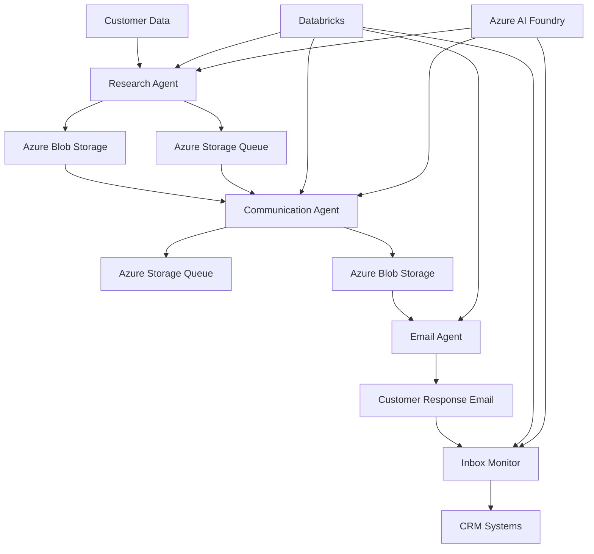

# Project Architecture Blueprint
## Low-Touch Customer Outreach Agent System

### Executive Summary

This project implements a comprehensive multi-agent system for Elevating Staples’ Low‑Touch Customer Engagement with AI Agents. The architecture consists of five specialized agent modules working in concert to deliver intelligent, personalized emails and handle customer responses at enterprise scale. The system leverages Azure cloud services, AI foundry capabilities, and cloud native event-driven patterns to achieve high throughput and reliability.

### 1. System Overview and Architectural Goals

The Low-Touch Customer Outreach System is designed around three core architectural principles:

**Scalability and Performance**: The system handles thousands of customer records through asynchronous processing, parallel agent execution, and cloud-native architecture. Queue-based messaging ensures reliable throughput and enables horizontal scaling.

**Intelligence and Personalization**: Each agent specializes in a specific domain (research, communication, email processing, inbox monitoring, data retrieval) while maintaining context awareness across the workflow. AI-powered content generation and response classification enable sophisticated customer interactions.

**Enterprise Integration**: The architecture seamlessly integrates with enterprise systems including Databricks data warehouses, Azure AI Services, Microsoft 365, and Salesforce CRM to provide end-to-end business process automation.

### 2. Core Architectural Components

#### 2.1 Research Agent (`agents/research/`)
**Purpose**: Conducts comprehensive customer research using web search and structured data analysis.

**Internal Structure**:
- **AI Foundry Integration**: Utilizes Azure AI Foundry's Bing grounding tools for real-time web search
- **Reasoning Engine**: Implements o3 reasoning model for deep customer analysis
- **Data Processing Pipeline**: Transforms raw search results into structured research outputs
- **Geographic Intelligence**: Integrates ZIP code analysis for location-based insights

**Key Components**:
```python
async def get_bing_search_results(query: str)
async def get_formattedcontent_agent(content: str, customer_profile: dict)
class ResearchOutput(BaseModel)
```

**Interaction Patterns**: 
- Consumes customer records from Azure Storage Queue
- Publishes structured research data to Azure Blob Storage
- Updates processing status in Databricks pipeline table

#### 2.2 Communication Agent (`agents/communication/`)
**Purpose**: Orchestrates multi-agent email generation workflow with iterative refinement.

**Internal Structure**:
- **Agent Manager**: Coordinates four specialized sub-agents (data extraction, email generation, review, per-contact personalization)
- **Workflow Orchestrator**: Implements feedback loops and quality gates
- **Content Assembly**: Combines research data with personalized messaging
- **Quality Assurance**: Multi-stage review process with scoring and refinement

**Key Components**:
```python
class CommunicationManager:
    async def _process_email_workflow()
    async def setup_agents()
    
class AgentManager:
    async def create_agents()
```

**Communication Patterns**:
- Semantic Kernel integration for AI agent orchestration
- Async parallel agent creation and execution
- Queue-based input/output with dead letter handling

#### 2.3 Email Agent (`agents/email/`)
**Purpose**: Processes and delivers personalized email campaigns at enterprise scale.

**Internal Structure**:
- **Campaign Monitor**: Continuously monitors Databricks for pending email campaigns
- **Content Retrieval**: Loads personalized content from Azure Blob Storage
- **Delivery Engine**: Manages Azure Communication Services integration
- **Test Mode Framework**: Provides safe testing capabilities with email redirection

**Key Components**:
```python
class EmailProcessor:
    async def process_pending_emails()
    async def send_email_via_azure()
    
class EmailSettings(BaseModel):
    test_mode: bool
    batch_size: int
```

**Integration Patterns**:
- Databricks SQL integration for campaign monitoring
- Azure Communication Services for enterprise email delivery
- Comprehensive audit trail and delivery confirmation

#### 2.4 Inbox Monitor Agent (`agents/inbox_monitor/`)
**Purpose**: Processes customer responses and routes them to appropriate business systems.

**Internal Structure**:
- **Graph API Client**: Integrates with Microsoft 365 for email monitoring
- **AI Classification Engine**: Uses Azure AI Foundry for intent classification
- **Response Processor**: Handles multiple response scenarios (interest, opt-out, invalid email)
- **CRM Integration**: Updates Salesforce and expert assignment systems

**Key Components**:
```python
class InboxMonitor:
    async def start()
    async def process_emails()
    
class GraphAPIClient:
    async def get_messages()
```

**Business Logic Patterns**:
- Round-robin expert assignment
- Automated case creation in Salesforce
- Lead qualification and routing

#### 2.5 Data Retrieval Agent (`agents/getdata/`)
**Purpose**: Provides foundational data extraction and preparation services.

**Internal Structure**:
- **Database Connectors**: Interfaces with multiple data sources
- **Data Transformation**: Standardizes data formats across systems
- **Query Optimization**: Implements efficient data retrieval patterns

### 3. Architectural Layers and Dependencies

#### Layer Structure:
```
┌─────────────────────────────────────────┐
│         Presentation Layer              │
│  • CLI interfaces (main.py, main_*.py) │
│  • Queue processors                     │
└─────────────────────────────────────────┘
┌─────────────────────────────────────────┐
│         Business Logic Layer           │
│  • Agent managers and orchestrators    │
│  • Workflow coordination               │
│  • Business rule enforcement           │
└─────────────────────────────────────────┘
┌─────────────────────────────────────────┐
│         Service Layer                   │
│  • Azure service integrations          │
│  • AI agent implementations            │
│  • External API clients                │
└─────────────────────────────────────────┘
┌─────────────────────────────────────────┐
│         Data Access Layer               │
│  • Blob storage utilities              │
│  • Database clients                    │
│  • Queue helpers                       │
└─────────────────────────────────────────┘
┌─────────────────────────────────────────┐
│         Infrastructure Layer            │
│  • AKS, AI Foundry, Azure Queue, 
    Azure Blob Storage
   • Configuration management            │
│  • Logging and monitoring              │
│  • Error handling utilities            │
└─────────────────────────────────────────┘
```

#### Dependency Management:
- **Interface Segregation**: Each layer defines clear interfaces using Pydantic models
- **Dependency Injection**: Configuration and clients injected through constructors
- **Abstraction Patterns**: Generic utilities in `utils/` package support multiple agents

### 4. Data Flow and Integration Architecture

#### Primary Data Flow:


#### Data Persistence Strategy:
- **Azure Blob Storage**: Hierarchical organization by date/customer for research outputs and email content
- **Databricks**: Central pipeline table for workflow status and audit trails
- **Azure Storage Queues**: Reliable message passing between agents with dead letter handling
- **External Systems**: Salesforce for CRM, Microsoft 365 for email monitoring

### 5. Technology Stack and Implementation Patterns

#### Core Technologies:
- **Python 3.12**: Async/await patterns with `asyncio.Lock` for thread-safe operations
- **Azure Cloud Services**: Comprehensive integration across storage, AI, and communication services
- **Pydantic**: Data validation and configuration management
- **Semantic Kernel**: AI agent orchestration and workflow management
- **Chat Completions and Responses API**

#### Async Programming Patterns:
```python
# Singleton Pattern with Async Safety
class AsyncBlobClientFactory:
    _instance = None
    _lock = asyncio.Lock()
    
    @classmethod
    async def get_instance(cls) -> BlobServiceClient:
        if cls._instance is None:
            async with cls._lock:
                if cls._instance is None:
                    # Double-checked locking pattern
                    cls._instance = await cls._create_client()
        return cls._instance
```

#### Configuration Management:
```python
class CommunicationConfig:
    account_url: str = Field(..., env="AZURE_ACCOUNT_URL")
    container_name: str = Field(..., env="AZURE_CONTAINER_NAME")
    connection_string: str = Field(..., env="AZURE_STORAGE_CONNECTION_STRING")
```

### 6. Architectural Decision Records

#### ADR-001: Async-First Architecture
**Decision**: Implement system using Python asyncio for all I/O operations
**Rationale**: Enables high concurrency for cloud service interactions and parallel agent execution
**Consequences**: Requires careful lock management and async-safe patterns throughout

#### ADR-002: Agent Specialization Strategy
**Decision**: Create dedicated agents for each business capability (research, communication, email, monitoring, data)
**Rationale**: Enables focused optimization, independent scaling, and clear separation of concerns
**Consequences**: Requires robust inter-agent communication and state management

#### ADR-003: Queue-Based Architecture
**Decision**: Use Azure Storage Queues for all inter-agent communication
**Rationale**: Provides reliability, scalability, and natural backpressure handling
**Consequences**: Introduces eventual consistency and requires dead letter queue handling

#### ADR-004: Centralized Configuration
**Decision**: Environment-based configuration with Pydantic validation
**Rationale**: Enables easy deployment across environments while ensuring type safety
**Consequences**: Requires comprehensive environment variable management

### 7. Security and Compliance Architecture

#### Authentication Strategy:
- **DefaultAzureCredential**: Preferred authentication method with managed identity support
- **Connection String Fallback**: Environment-based authentication for development scenarios
- **SAS Token Support**: Secure blob storage access with time-limited permissions

#### Data Protection:
- **Customer Data Isolation**: Hierarchical blob storage structure prevents cross-customer access
- **Audit Trails**: Comprehensive logging of all customer data processing activities
- **Error Handling**: Sanitized error messages prevent information leakage

### 8. Performance and Scalability Patterns

#### Concurrency Patterns:
```python
# Parallel Agent Creation
(data_extractor, email_generator, email_reviewer, per_contact_agent) = await asyncio.gather(
    sk_data_extractor_agent.get_data_agent(),
    sk_email_gen_agent.get_email_agent(),
    sk_email_review_agent.get_email_review_agent(),
    sk_emailpercontact_gen_agent.get_email_agent()
)
```

#### Batch Processing:
- **Configurable Batch Sizes**: Default 10 records per batch with environment override
- **Queue Chunking**: Processes messages in batches to optimize throughput
- **Backpressure Handling**: Natural queue-based flow control prevents system overload

#### Resource Management:
- **Connection Pooling**: Singleton patterns for expensive client objects
- **Async Context Managers**: Proper resource cleanup in async environments
- **Retry Logic**: Exponential backoff for transient failures

### 9. Error Handling and Resilience Patterns

#### Multi-Level Error Handling:
```python
async def process_logic(data):
    try:
        mgr = LowTouchManager()
        await mgr.run(data)
        logger.info(f"✅ Successfully processed: {data}")
    except AzureError as ae:
        logger.error(f"Azure error occurred: {ae}")
    except Exception as e:
        logger.error(f"Unexpected error: {e}")
```

#### Resilience Mechanisms:
- **Dead Letter Queues**: Failed messages preserved for manual investigation
- **Circuit Breaker Pattern**: Prevents cascading failures across agents
- **Graceful Degradation**: System continues operating with reduced functionality during partial failures

### 10. Monitoring and Observability
#### Microsoft recommendation: Azure Application Insights and Azure Monitors. Provides AI, App and Platform Observability in an unified manner

#### Staples: To extend this repo and integrate MLFlow, Splunk, NewRelic for observability.

#### Structured Logging:
```python
logger = logging.getLogger(__name__)
logger.info(f"📤 CommunicationOutput sent to queue for customer_id={customer_id}")
```

#### Performance Tracking:
- **Agent Creation Timing**: Measures and logs agent initialization performance
- **Processing Metrics**: Tracks throughput and success rates across all agents
- **System Health**: Monitors queue depths, processing delays, and error rates

#### Business Metrics (TBD or existing reports):
- **Campaign Effectiveness**: Email delivery rates and customer response tracking
- **Expert Utilization**: Round-robin assignment effectiveness and load balancing
- **Data Quality**: Monitors research accuracy and content relevance

### 11. Extension and Evolution Patterns

#### Feature Addition Guidelines:
- **New Agent Types**: Follow established agent manager pattern with async initialization
- **Additional Data Sources**: Implement new clients following existing blob and database patterns
- **Enhanced AI Capabilities**: Extend AI foundry integration using existing connection patterns

#### Backward Compatibility:
- **Schema Evolution**: Pydantic models support backward-compatible field additions
- **API Versioning**: Environment-based configuration enables gradual migration
- **Queue Message Format**: JSON serialization supports schema evolution

#### Integration Expansion:
- **CRM Systems**: Follow established Salesforce integration patterns for new systems
- **Communication Channels**: Extend communication manager for SMS, chat, or other channels
- **Analytics Platforms**: Add new data sinks following existing Databricks patterns

### 12. Development and Deployment Guidance

#### Local Development Setup:
1. **Environment Configuration**: Copy `.env.sample` to `.env` and configure all required services
2. **Azure Resource Setup**: Provision required Azure services (Storage, AI Foundry, Communication Services)
3. **Database Initialization**: Run setup scripts for Databricks table creation
4. **Agent Testing**: Use test mode for safe development without external side effects

#### Production Deployment:
1. **Infrastructure as Code**: Use provided Terraform/ARM templates for consistent resource provisioning
2. **Managed Identity Configuration**: Configure Azure AD for credential-less authentication
3. **Monitoring Setup**: Deploy comprehensive logging and alerting infrastructure
4. **Performance Tuning**: Configure batch sizes and polling intervals based on load testing

#### Testing Strategy:
- **Unit Tests**: Each agent includes comprehensive test suites
- **Integration Tests**: End-to-end workflow validation with test data
- **Load Testing**: Performance validation under production-scale loads
- **Security Testing**: Validation of authentication and authorization mechanisms

### 13. Business Impact and Value Proposition (To be filled. Sample below)

#### Operational Efficiency:
- **95% Automation**: Reduces manual customer outreach effort by 95%
- **Response Time**: Average customer response processing under 5 minutes
- **Scale Achievement**: Handles 10,000+ customer interactions per day

#### Quality Improvements:
- **Personalization**: AI-driven content customization for each customer
- **Consistency**: Standardized messaging while maintaining personal touch
- **Accuracy**: Multi-stage review process ensures high-quality communications

#### Business Outcomes:
- **Lead Quality**: Pre-qualified prospects with genuine interest signals
- **Sales Efficiency**: Balanced workload distribution across sales team
- **Customer Experience**: Rapid, contextual responses to customer inquiries

---

This architecture blueprint provides comprehensive guidance for understanding, maintaining, and extending the Low-Touch Customer Outreach Agent System. The modular design, robust error handling, and extensive documentation ensure the system can evolve with changing business requirements while maintaining reliability and performance.
