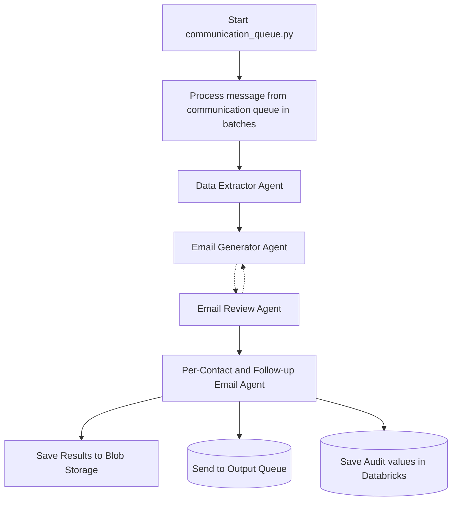

# Communication Agent: Queue Processing Flow

This module simulates the full communication agent workflow using Azure Storage Queues and multiple AI agents.

## Overview

The main entry point is [`communication_queue.py`](./communication_queue.py).
This script does the following:

1. **Creates test records** and sends them to the communication queue.
2. **Processes messages** from the queue in batches, simulating the communication agent flow.
3. **Uses four agents** in sequence:
   - **Data Extractor Agent:** Extracts research output from the message.
   - **Email Generator Agent:** Generates an email using the extracted research.
   - **Email Review Agent:** Reviews the generated email.
   - **Per-Contact Email Agent:** Generates contact-specific emails and follow-ups.

## How to Run

> **Note:**
> Due to Python import path issues, you should run the communication agent as a module using VS Code's launch configuration, not by running `python communication_queue.py` directly.

### Using VS Code

1. **Open the project in VS Code.**
2. **Ensure your `.env` file is set up** (copy from `.env.sample` and fill in secrets).
3. **Open the Run and Debug panel** (Ctrl+Shift+D).
4. **Select the configuration** named `Python Debugger: Module`.
5. **Click "Run" or "Start Debugging"**.

This will run the following as a module:

```
python -m agents.communication.communication_queue
```

### Why use this approach?

- Running as a module (`-m`) ensures all relative and absolute imports work correctly.
- The provided `.vscode/launch.json` is already configured for this.

## Source Code Links

- [communication_queue.py](./communication_queue.py): Main entry point and queue processor.
- [communication_manager.py](./communication_manager.py): Orchestrates the agent workflow for each message.
- [models.py](./models.py): Pydantic models for all data structures.
- [utils/azurequeuehelper.py](../utils/azurequeuehelper.py): Azure Storage Queue helper.
- [utils/agentloghelper.py](../utils/agentloghelper.py): Test record creation and serialization.

## Flow Diagram



## Notes

- The script will run indefinitely, polling the queue and processing new messages as they arrive.
- You can adjust batch size and polling interval in the code.
- All agent logic and message handling is orchestrated by the [`CommunicationManager`](./communication_manager.py).
