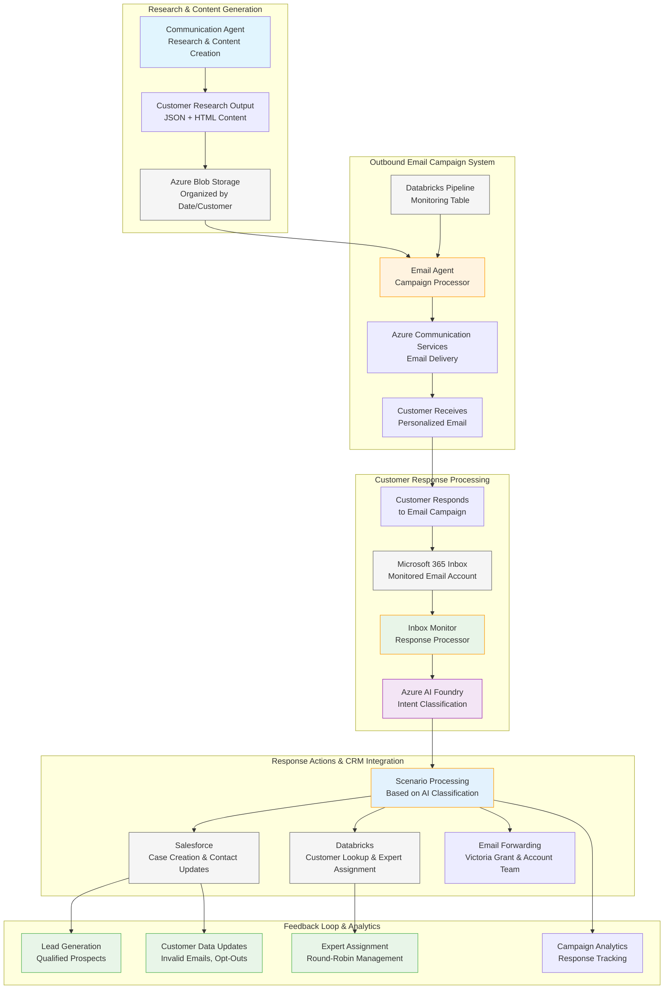
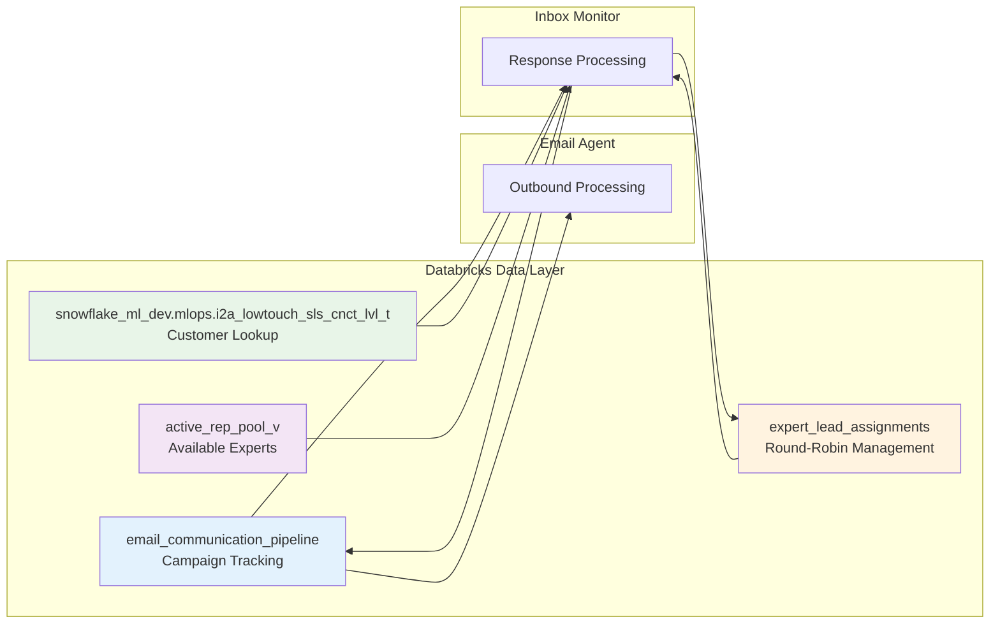

# Integrated Email Communication System Overview

## Complete System Architecture

## Data Flow Integration Points

### 1. **Shared Data Sources**

### 2. **Process Integration Timeline**

```mermaid
gantt
    title Email Communication System Timeline
    dateFormat X
    axisFormat %d
    
    section Outbound Campaign
    Research Complete    :done, research, 0, 1d
    Content Generation   :done, content, after research, 1d
    Email Processing     :done, email_proc, after content, 1d
    Email Delivery       :done, delivery, after email_proc, 1d
    
    section Customer Response
    Customer Receives    :crit, receive, after delivery, 1d
    Customer Responds    :respond, after receive, 3d
    
    section Response Processing
    Email Classification :active, classify, after respond, 1d
    Scenario Processing  :scenario, after classify, 1d
    CRM Integration      :crm, after scenario, 1d
    
    section Follow-up Actions
    Expert Assignment    :expert, after crm, 1d
    Lead Follow-up       :followup, after expert, 5d
```

## System Integration Benefits

### **1. Complete Customer Journey Tracking**
- **End-to-End Visibility**: From initial outreach to response processing
- **Unified Customer Data**: Single source of truth across Databricks and Salesforce
- **Campaign Effectiveness**: Measure response rates and conversion metrics

### **2. Automated Response Handling**
- **AI-Powered Classification**: Intelligent categorization of customer responses
- **Scenario-Based Actions**: Automated routing based on response type
- **Expert Load Balancing**: Fair distribution of leads across sales team

### **3. Data Quality Management**
- **Real-Time Updates**: Invalid emails immediately flagged and updated
- **Opt-Out Compliance**: Automatic handling of unsubscribe requests
- **Contact Data Hygiene**: Continuous improvement of customer database

### **4. Scalable Operations**
- **Batch Processing**: Handle high-volume campaigns efficiently
- **Parallel Processing**: Independent operation of outbound and inbound systems
- **Error Recovery**: Resilient handling of service failures

## Key Performance Indicators (KPIs)

### **Campaign Metrics**
- **Email Delivery Rate**: Successfully sent emails / Total attempted
- **Response Rate**: Customer responses / Emails delivered
- **Classification Accuracy**: Correctly classified responses / Total responses

### **Lead Generation Metrics**
- **Positive Response Rate**: Positive responses / Total responses
- **Expert Assignment Time**: Time from positive response to expert assignment
- **Case Creation Success**: Successfully created cases / Positive responses

### **Data Quality Metrics**
- **Invalid Email Detection**: Bounced emails identified and flagged
- **Opt-Out Processing**: Unsubscribe requests handled within SLA
- **Contact Data Accuracy**: Up-to-date contact information percentage

### **System Performance Metrics**
- **Processing Time**: Average time from email receipt to action completion
- **Error Rate**: Failed operations / Total operations
- **Service Availability**: System uptime and service health

## Business Value Proposition

### **For Sales Teams**
- **Qualified Leads**: Pre-screened prospects with genuine interest
- **Balanced Workload**: Fair distribution of opportunities
- **Context-Rich Cases**: Complete customer history and interaction details

### **For Marketing Teams**
- **Campaign Analytics**: Detailed response tracking and effectiveness metrics
- **Customer Insights**: Understanding of customer preferences and behaviors
- **Data Quality**: Clean, up-to-date contact information

### **For Operations Teams**
- **Automated Processing**: Reduced manual intervention requirements
- **Error Handling**: Comprehensive monitoring and recovery procedures
- **Scalability**: Handle growing volume without proportional resource increase

### **For Customer Experience**
- **Prompt Response**: Quick routing of inquiries to appropriate teams
- **Personalized Follow-up**: Contextual engagement based on response type
- **Preference Respect**: Honor opt-out and communication preferences