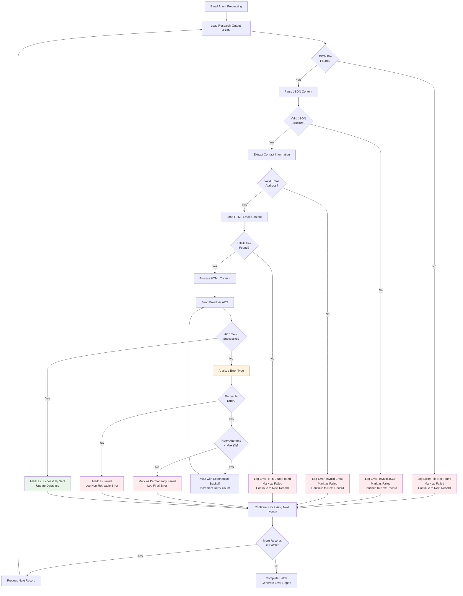

# Outbound Email Campaign - Error Handling & Retry Logic

## Error Handling Workflow



## Error Categories & Recovery Strategies

### 1. **Configuration Errors** (Non-Retryable)
**Symptoms**: Missing connection strings, invalid credentials
**Recovery**: Manual configuration fix required
**Actions**: 
- Log critical error
- Stop processing until configuration resolved
- Alert system administrators

### 2. **File System Errors** (Retryable)
**Symptoms**: Blob storage access failures, temporary network issues
**Recovery**: Exponential backoff retry (3 attempts)
**Actions**:
- Wait periods: 1s, 2s, 4s
- Log each retry attempt
- Mark as failed after max attempts

### 3. **Data Validation Errors** (Non-Retryable)
**Symptoms**: Invalid email addresses, malformed JSON, missing required fields
**Recovery**: Skip record, continue processing
**Actions**:
- Log validation error details
- Mark specific record as failed
- Continue with remaining batch

### 4. **Azure Communication Services Errors**

#### **Retryable ACS Errors**:
- **Rate Limiting (429)**: Wait and retry with exponential backoff
- **Service Unavailable (503)**: Temporary service issue, retry
- **Network Timeouts**: Connection issues, retry
- **Internal Server Error (500)**: Temporary Azure issue, retry

#### **Non-Retryable ACS Errors**:
- **Invalid Sender (401)**: Configuration problem
- **Invalid Recipient (400)**: Bad email address format
- **Domain Suppressed**: Email address on suppression list
- **Content Rejected**: Email content violates policies

### 5. **Database Errors** (Retryable)
**Symptoms**: Databricks connection failures, query timeouts
**Recovery**: Connection retry with backoff
**Actions**:
- Attempt database reconnection
- Retry failed database operations
- Log connection issues for monitoring

## Retry Logic Implementation

### **Exponential Backoff Strategy**
```
Retry 1: Wait 1 second
Retry 2: Wait 2 seconds  
Retry 3: Wait 4 seconds
After 3 attempts: Mark as failed
```

### **Error Tracking Database Fields**
- `send_status`: 'sent', 'failed', 'retrying'
- `error_message`: Detailed error description
- `retry_count`: Number of retry attempts
- `last_retry_timestamp`: Time of last retry attempt

### **Monitoring & Alerts**
- **Success Rate Monitoring**: Alert if success rate drops below 90%
- **Error Pattern Detection**: Alert on recurring error types
- **Service Health Checks**: Monitor Azure service availability
- **Configuration Validation**: Daily validation of all settings

## Recovery Procedures

### **Partial Batch Failures**
- Continue processing remaining records in batch
- Generate detailed error report with failed record IDs
- Allow manual retry of failed records after issue resolution

### **Complete Service Failures**
- Graceful shutdown with connection cleanup
- Preserve processing state for restart
- Generate incident report with error details
- Manual intervention required for service restoration