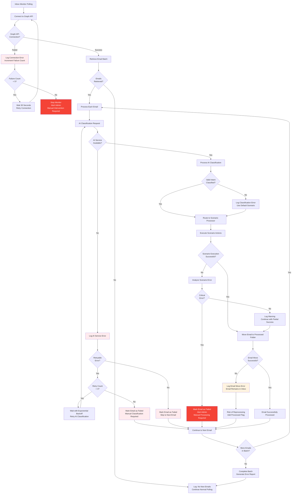

# Inbound Email Response - Error Handling & Retry Logic

## Error Handling Workflow



## Error Categories & Recovery Strategies

### 1. **Graph API Connection Errors**

#### **Retryable Connection Issues**:
- **Network Timeouts**: Temporary connectivity problems
- **Rate Limiting (429)**: Microsoft Graph API throttling
- **Service Unavailable (503)**: Temporary Azure AD issues
- **Token Expiration**: OAuth token needs refresh

**Recovery Strategy**:
```
Attempt 1: Immediate retry
Attempt 2: Wait 30 seconds, retry
Attempt 3: Wait 60 seconds, retry
Attempt 4: Wait 120 seconds, retry
Attempt 5: Wait 300 seconds, retry
After 5 failures: Stop monitor, alert admin
```

#### **Non-Retryable Connection Issues**:
- **Invalid Credentials (401)**: Authentication configuration problem
- **Insufficient Permissions (403)**: Missing Graph API permissions
- **Tenant Not Found (404)**: Invalid tenant configuration

**Recovery Strategy**: Immediate failure, admin intervention required

### 2. **AI Classification Errors**

#### **Azure AI Foundry Service Errors**:
- **Service Unavailable**: Temporary AI service outage
- **Rate Limiting**: AI service quota exceeded
- **Model Deployment Issues**: AI model not available
- **Invalid Request Format**: Malformed classification request

**Recovery Strategy**:
```
Retry 1: Wait 1 second, retry
Retry 2: Wait 2 seconds, retry  
Retry 3: Wait 4 seconds, retry
After 3 attempts: Use fallback classification or manual review
```

#### **Low Confidence Classifications**:
- **Confidence < 0.6**: Uncertain AI classification
- **Ambiguous Content**: Email content unclear
- **Mixed Intents**: Multiple possible classifications

**Recovery Strategy**: 
- Flag for manual review
- Use conservative default scenario (forward to Victoria Grant)
- Log for model improvement

### 3. **Scenario Processing Errors**

#### **Databricks Connection Failures**:
- **Database Unavailable**: Databricks warehouse not running
- **Query Timeouts**: Long-running database queries
- **Permission Issues**: Invalid access tokens
- **Data Not Found**: Customer not in lookup table

**Recovery Strategy**:
- Retry database connection (3 attempts)
- Use exponential backoff (1s, 2s, 4s)
- If customer not found: Forward to Victoria Grant for manual handling

#### **Salesforce API Errors**:
- **Rate Limiting**: Salesforce API quota exceeded
- **Invalid Data**: Malformed case creation request  
- **Permission Issues**: Insufficient Salesforce permissions
- **Field Validation**: Required fields missing or invalid

**Recovery Strategy**:
- Retry with exponential backoff (3 attempts)
- Validate data before retry
- Log detailed error for manual case creation

#### **Round-Robin Assignment Failures**:
- **No Available Experts**: All experts at capacity
- **Assignment Table Lock**: Concurrent assignment conflicts
- **Invalid Expert Data**: Expert no longer active

**Recovery Strategy**:
- Retry assignment selection
- Fall back to manual assignment
- Alert management of capacity issues

### 4. **Email Forwarding Errors**

#### **Email Agent Subprocess Failures**:
- **Process Creation Failed**: System resource issues
- **Email Send Failed**: SMTP delivery problems
- **Timeout**: Email agent not responding

**Recovery Strategy**:
- Retry subprocess creation (2 attempts)
- Use alternative email delivery method
- Log failed forwards for manual processing

### 5. **Email Management Errors**

#### **Folder Operations**:
- **Cannot Create Processed Folder**: Permission issues
- **Cannot Move Email**: Graph API limitations
- **Duplicate Processing**: Email processed multiple times

**Recovery Strategy**:
- Add processed flag to prevent reprocessing
- Use alternative folder structure if needed
- Log email IDs for tracking

## Monitoring & Alerting

### **Critical Alerts** (Immediate Response Required)
- Graph API connection failures (5 consecutive)
- AI service unavailable for > 30 minutes
- Databricks connection failures for > 15 minutes
- Salesforce API errors > 50% failure rate

### **Warning Alerts** (Review Within 4 Hours)
- AI classification confidence < 0.6 for > 10% of emails
- Email forwarding failures > 5% of attempts
- Round-robin assignment failures
- Email folder management issues

### **Informational Alerts** (Daily Review)
- Processing statistics and trends
- Error rate summaries
- Performance metrics
- Capacity planning indicators

## Recovery Procedures

### **Partial Service Failures**
1. **Identify Failed Component**: Determine which service is failing
2. **Isolate Impact**: Continue processing where possible
3. **Queue Failed Operations**: Store for retry when service recovers
4. **Manual Fallback**: Use manual procedures for critical operations

### **Complete System Failures**
1. **Graceful Shutdown**: Stop processing, preserve state
2. **Alert Stakeholders**: Notify operations team and business users
3. **Diagnostic Collection**: Gather logs and error details
4. **Recovery Planning**: Determine manual procedures and service restoration

### **Data Consistency Issues**
1. **Email Reprocessing**: Handle emails processed multiple times
2. **Assignment Conflicts**: Resolve duplicate expert assignments
3. **Salesforce Sync**: Ensure case creation consistency
4. **Audit Trail**: Maintain complete processing history