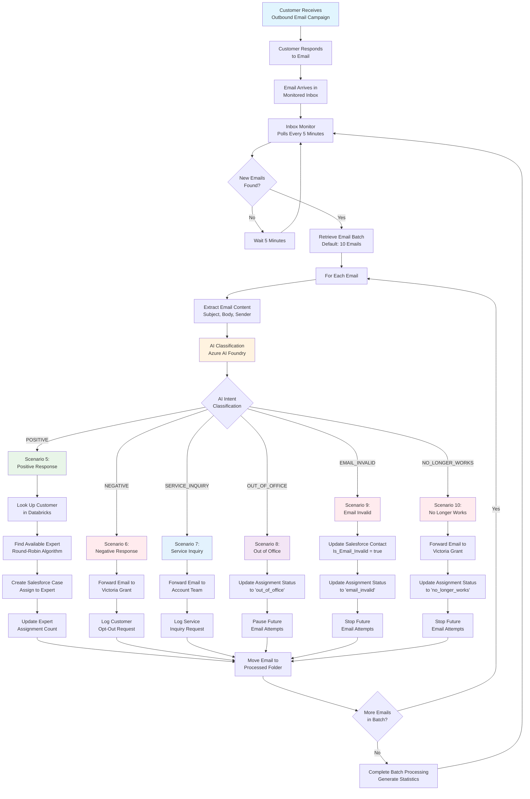

# Inbound Email Response Processing Workflow

## Business Process Flow - Happy Path



## AI Classification Details

### Intent Categories & Confidence Scoring

```mermaid
graph LR
    A[Email Content] --> B[Azure AI Foundry<br/>Semantic Kernel]
    B --> C{AI Analysis}
    C --> D[Intent Classification<br/>Confidence Score 0.0-1.0]
    D --> E[Reasoning Explanation]
    D --> F[Key Phrases Extracted]
    
    G[POSITIVE Examples:<br/>• "Very interested"<br/>• "Please call me"<br/>• "Want to learn more"] --> H[Confidence: 0.85-0.98]
    I[NEGATIVE Examples:<br/>• "Remove me"<br/>• "Not interested"<br/>• "Stop contacting"] --> J[Confidence: 0.90-0.99]
    K[SERVICE_INQUIRY Examples:<br/>• "Question about order"<br/>• "Need support"<br/>• "Account issue"] --> L[Confidence: 0.75-0.95]
    
    style B fill:#fff3e0
    style H fill:#e8f5e8
    style J fill:#ffebee
    style L fill:#e3f2fd
```

## Scenario Processing Details

### Scenario 5: Positive Response (Lead Generation)
**Business Objective**: Convert interested prospects into qualified leads
**Process**:
1. Validate customer exists in Databricks lookup table
2. Find next available expert using round-robin algorithm
3. Create Salesforce case with full customer context
4. Assign case to selected expert for follow-up
5. Update expert assignment metrics

**Key Data Points**:
- Customer Account ID and Contact ID from Databricks
- Expert assignment based on workload balancing
- Case creation with complete email thread context

### Scenario 6: Negative Response (Opt-Out Management)
**Business Objective**: Respect customer preferences and maintain compliance
**Process**:
1. Forward original email to Victoria Grant for review
2. Log customer opt-out request in system
3. Potential manual follow-up for relationship management

### Scenario 7: Service Inquiry (Customer Support)
**Business Objective**: Route existing customers to appropriate support
**Process**:
1. Forward email to dedicated account management team
2. Ensure existing customers receive proper support
3. Maintain customer satisfaction for current relationships

### Scenario 8: Out of Office (Temporary Pause)
**Business Objective**: Respect temporary unavailability
**Process**:
1. Update assignment status in Databricks
2. Temporarily pause email campaigns for this contact
3. Allow for future re-engagement when appropriate

### Scenario 9: Email Invalid (Data Hygiene)
**Business Objective**: Maintain clean contact databases
**Process**:
1. Update Salesforce contact record with invalid email flag
2. Update assignment system to prevent future attempts
3. Maintain data quality across all systems

### Scenario 10: No Longer Works (Contact Update)
**Business Objective**: Keep contact information current
**Process**:
1. Forward to Victoria Grant for contact database updates
2. Stop future email attempts to this address
3. Potential research for new contact information

## Integration Points with Outbound System

### Data Flow Connection
1. **Outbound Campaign** sends emails to prospects
2. **Customer Responses** arrive in monitored inbox
3. **Response Processing** creates feedback loop
4. **Lead Generation** feeds back into CRM for sales follow-up

### Database Synchronization
- **Shared Databricks Tables**: Customer lookup and assignment tracking
- **Salesforce Integration**: Case creation and contact status updates
- **Assignment Management**: Round-robin expert allocation across both systems