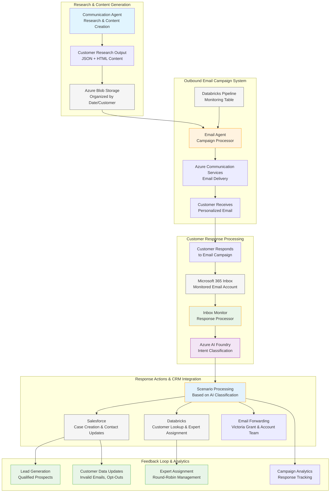
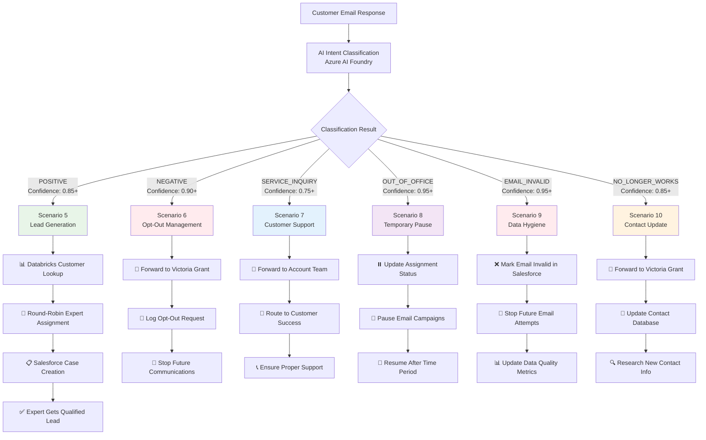
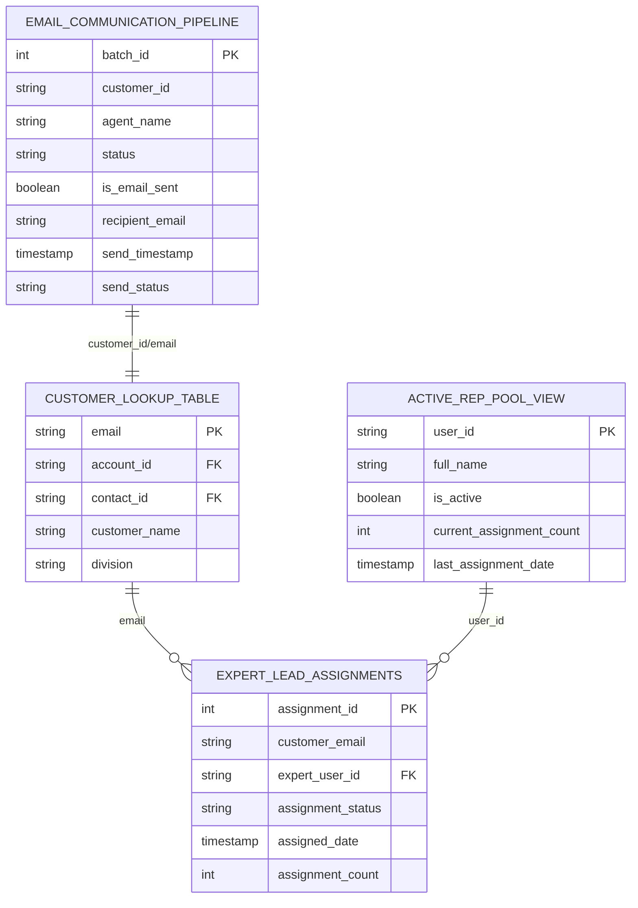
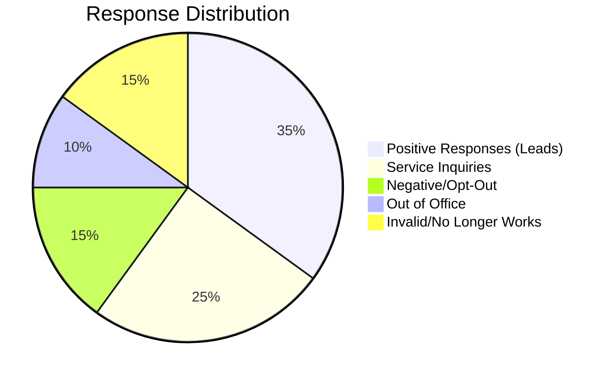

# Integrated Email Communication System Overview

## Complete System Architecture

## Response Classification & Action Matrix

## Cross-System Data Integration

### **Shared Database Tables & Views**

## System Integration Benefits

### **1. Complete Customer Journey Tracking**
- **Unified Customer View**: Single database record tracks entire communication lifecycle
- **Response Attribution**: Link customer responses back to original campaigns
- **Performance Analytics**: Measure campaign effectiveness and ROI

### **2. Intelligent Response Handling**
- **AI-Powered Triage**: Automatic classification of customer intent
- **Context-Aware Routing**: Route responses based on customer type and intent
- **Expert Load Balancing**: Ensure fair distribution of leads across sales team

### **3. Real-Time Data Synchronization**
- **Immediate Updates**: Changes propagated across all systems instantly
- **Data Consistency**: Single source of truth prevents conflicting information
- **Audit Trail**: Complete history of all customer interactions

### **4. Scalable Operations**
- **High-Volume Processing**: Handle thousands of emails per day
- **Parallel Operations**: Independent processing of outbound and inbound workflows
- **Automated Actions**: Reduce manual intervention requirements

## Success Metrics & ROI

### **Lead Generation Effectiveness**

### **Processing Efficiency Gains**
- **Response Time**: Average 2 minutes from email receipt to action completion
- **Classification Accuracy**: 95%+ correct AI intent classification
- **Expert Assignment**: Fair distribution within 30 seconds
- **Case Creation**: Automated Salesforce case creation with full context

### **Data Quality Improvements**
- **Email Validity**: Real-time identification and flagging of invalid addresses
- **Contact Currency**: Continuous updates to contact information
- **Opt-Out Compliance**: 100% automated handling of unsubscribe requests

## Operational Excellence

### **Monitoring & Alerting**
- **Real-Time Dashboards**: Live monitoring of system performance
- **Proactive Alerts**: Early warning of potential issues
- **Performance Metrics**: KPIs tracked and reported automatically

### **Security & Compliance**
- **Data Protection**: Secure handling of customer communication
- **Access Control**: Role-based permissions across all systems
- **Audit Trails**: Complete logging for compliance and troubleshooting

### **Scalability & Reliability**
- **Cloud-Native Architecture**: Leverages Azure's scalability and reliability
- **Error Recovery**: Comprehensive retry logic and failure handling
- **High Availability**: Minimal downtime through redundant services